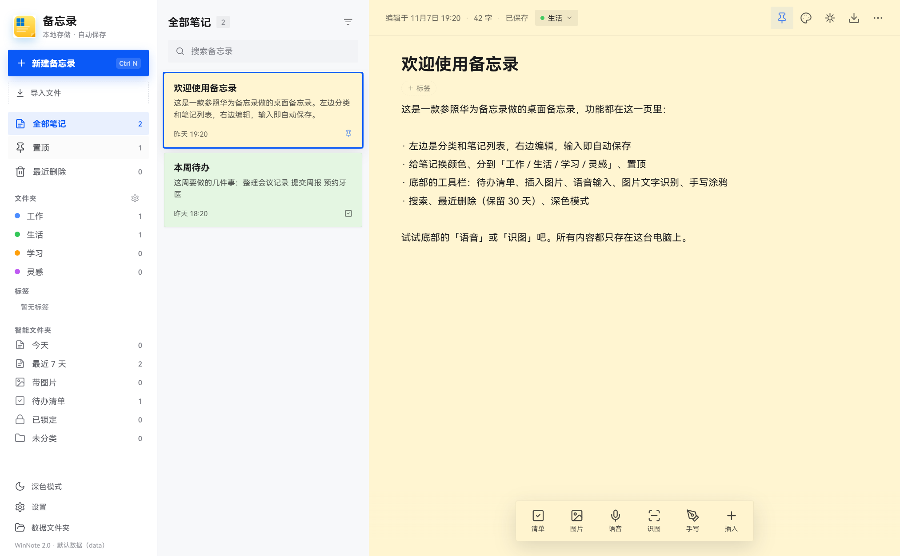

# WinNote 备忘录

仿华为备忘录的 Windows 桌面备忘录，WPF + WebView2 界面，数据全部保存在本机。



当前版本：1.0.0

## 这个仓库

- GitHub：<https://github.com/WiseWang1013/WinNote>
- 仓库名 **WinNote**，与程序 `WinNote.exe` 同名；界面里的中文名是「备忘录」。
- 详细架构、技术选型、导入导出流程、开发模型说明：[ARCHITECTURE.md](ARCHITECTURE.md)

## 下载

- 发布页：<https://github.com/WiseWang1013/WinNote/releases/tag/v1.0.0>
- 直接下载：<https://github.com/WiseWang1013/WinNote/releases/download/v1.0.0/WinNote.exe>

## 技术栈与开发方式

- 桌面外壳：**C# / .NET 10 / WPF**
- 界面：**原生 HTML5 + CSS3 + JavaScript**，运行在 **WebView2** 里（没有 Vue / React）
- 语音：Windows 自带 **SAPI** 中文识别（离线）
- 图片文字识别：Windows 自带 **Windows.Media.Ocr**（离线）
- 导入导出：自写 MIME 邮件解析、Markdown 解析、DOCX Open XML、PDF 渲染/打印管线
- 数据：本地 JSON + 图片文件，不联网
- 开发工具：**DeepSeek Harness（DSH）** AI 编码代理 + PowerShell + `dotnet` CLI
- 开发模型：主要使用 **DeepSeek Flash**（`deepseek-account/deepseek-flash`，界面标识 `DeepSeek-V4.1-Flash High`）；会话早期（项目起步阶段）也使用过 **GLM-5.3-Flash**（`our-free-model/glm-5.3-flash-free`）
- 总体思路：WPF 负责原生窗口/DPI/关闭前保存，WebView2 负责界面与富文本编辑，JS 与 C# 用 `postMessage` 自建 Promise 桥通信；所有数据落在本机。

## 运行

从 [Releases](https://github.com/WiseWang1013/WinNote/releases/tag/v1.0.0) 下载 `WinNote.exe`，或直接双击本地：

```
D:\app\WinNote\WinNote.exe
```

- 无需安装 .NET（发布的是自包含单文件 exe）。
- 电脑需要 Microsoft Edge WebView2 Runtime（Windows 11 一般已自带）。
- 数据保存在 exe 旁边的 `data` 文件夹：
  - `data\notes.json`：全部笔记
  - `data\images\`：插入的图片、扫描图、手写涂鸦
  - `data\settings.json`：主题等设置
- 便携使用：把 `WinNote.exe` 和 `data` 文件夹一起拷走即可。

## 功能

- 左侧分类 + 笔记列表，右侧编辑，输入后自动保存
- 笔记颜色（10 种便签色）、工作/生活/学习/灵感分类、置顶
- 待办清单（点方框打勾）
- 插入图片、拖拽图片、粘贴图片
- 语音输入（Windows 自带中文语音识别，离线）
- 图片文字识别（Windows 自带 OCR，离线）
- 手写涂鸦
- 搜索、最近删除（保留 30 天）、深色模式
- Apple 式连续曲率圆角（`corner-shape: superellipse`）

## 导入

支持拖拽文件到窗口，或点侧边栏「导入文件」，也支持用 exe 打开文件（命令行参数）。

| 格式 | 说明 |
| --- | --- |
| `.txt` | 自动识别 UTF-8 / UTF-16 / GBK/GB18030 |
| `.md` / `.markdown` | 标题、列表、待办、引用、代码块、粗体斜体 |
| `.html` / `.htm` | 取网页正文，脚本/样式会清理，图片会导入 |
| `.mht` / `.mhtml` | 单文件网页 |
| `.eml` | 邮件正文、发件人/收件人/时间、内嵌图片（cid）、附件名列表 |
| `.docx` | Word 正文、标题、粗体/斜体、表格、图片 |
| `.doc` | 老版二进制 Word，调用本机 Word 转换；WPS 导出的 HTML 型 .doc 也可直接读 |
| `.rtf` | 基本文本与段落 |
| `.pdf` | 逐页渲染成图片，并自动 OCR 出文字 |
| `.png/.jpg/...` | 作为图片笔记导入，可再点「识图」提取文字 |
| `.hdoc` | 华为私有备份：如果是压缩包会尝试提取文本，否则给出提示 |

说明：

- `.msg` 是 Outlook 的二进制邮件格式，暂不支持；请在邮件客户端另存为 `.eml`。
- 华为 `.hdoc` 是加密备份包，电脑端通常无法直接解析；请在华为备忘录里先导出 TXT / HTML / PDF。
- `.doc` 转换依赖本机安装 Word；没有 Word 时会提示另存为 `.docx`。

## 导出

编辑器右上角的下载图标，或「更多 → 导出 / 分享…」。

| 格式 | 说明 |
| --- | --- |
| `.txt` | 纯文本，保留换行 |
| `.md` | Markdown，图片复制到 `文件名_assets` 文件夹 |
| `.docx` | Word 文档，保留标题、粗体/斜体、图片、待办 |
| `.pdf` | 通过 WebView2 打印为 A4 PDF，中文和图片都保留 |
| `.html` | 单文件网页，图片自动转成 base64 内嵌 |

## 快捷键

- `Ctrl + N`：新建备忘录
- `Ctrl + O`：导入文件
- `Ctrl + F`：搜索
- `Ctrl + S`：立即保存
- `Esc`：关闭弹层 / 结束语音

## 从源码编译

环境：Windows 10/11、.NET 10 SDK。

```powershell
dotnet publish .\src\WinNote\WinNote.csproj -c Release -r win-x64 --self-contained true -o .\dist
Copy-Item .\dist\WinNote.exe .\WinNote.exe -Force
```

或者直接运行：

```powershell
.\build.ps1
```

## 目录

```
WinNote.exe              发布后的单文件程序
data\                    运行后生成的数据
src\WinNote\             WPF + WebView2 源码
  wwwroot\               界面 HTML / CSS / JS
  Services\              导入导出、OCR、语音、存储
build.ps1                重新发布
README.md
```
